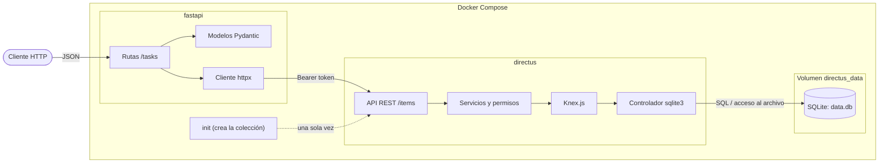
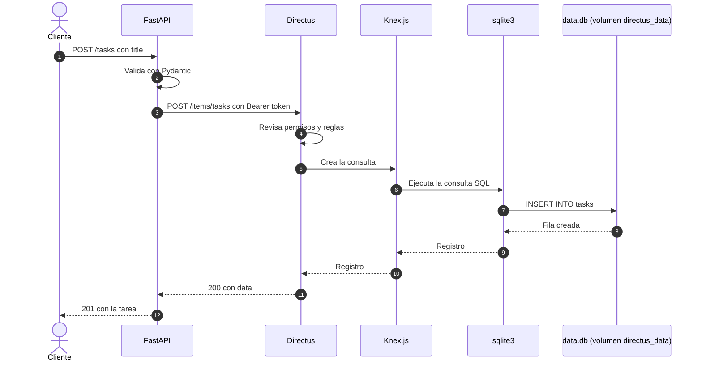
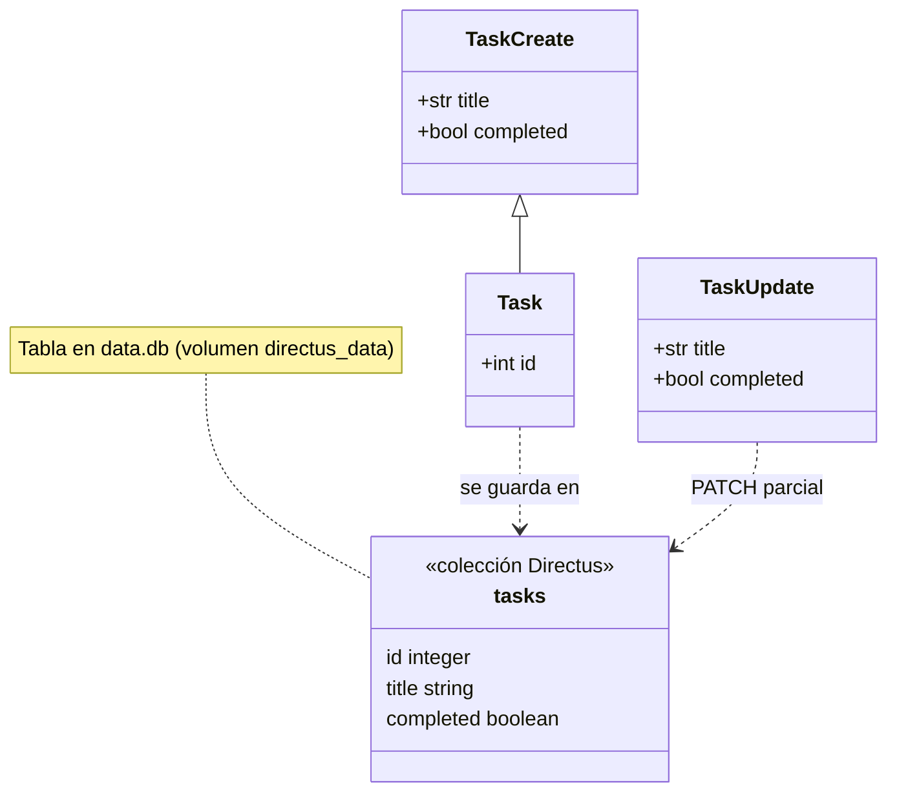

<div align="center">


# Directus + FastAPI

CRUD de tareas que muestra cómo una API en FastAPI puede apoyarse en Directus para guardar datos en SQLite


</div>

## Arquitectura

FastAPI valida las peticiones y las traduce a llamadas HTTP contra Directus. Directus aplica sus reglas y accede a SQLite mediante Knex.js, su constructor de consultas SQL, con el controlador `sqlite3`. Los datos se guardan en el archivo `data.db` del volumen `directus_data`. En el flujo del CRUD, solo Directus accede al archivo.



## Flujo de una petición

Así viaja un `POST /tasks` desde el cliente hasta la base y de vuelta.



## Modelo



## Servicios

| Servicio | Imagen | Rol | Puerto |
| --- | --- | --- | --- |
| `directus` | Directus 11 | API de datos, panel y acceso al archivo SQLite | 8055 |
| `init` | Imagen propia | Crea la colección `tasks` y termina | ninguno |
| `fastapi` | Imagen propia | Expone el CRUD | 8000 |

El orden de arranque es `directus`, `init` y `fastapi`. Cuando Directus está saludable, `init` crea la colección; al terminar correctamente, arranca FastAPI. SQLite no necesita un servicio aparte.

## Entender el backend

FastAPI valida los datos con Pydantic y usa `httpx` para llamar a Directus; no ejecuta SQL. Directus gestiona la colección `tasks`, sus permisos y las consultas que Knex.js ejecuta mediante `sqlite3`. El archivo `/directus/database/data.db` contiene tanto las tareas como las tablas internas de Directus.

Con los servicios levantados y la herramienta `sqlite3` instalada, puedes copiar la base e inspeccionar su esquema:

```bash
docker compose cp directus:/directus/database/data.db ./data.db
sqlite3 data.db .schema
```

La tabla `tasks` tiene las columnas `id`, `title` y `completed`. La copia permite leer el esquema localmente; modificarla no cambia la base que usa Directus. `data.db` y sus archivos auxiliares quedan excluidos de Git y del contexto Docker.

## Uso

```bash
python3 scripts/configure.py
docker compose up --build --wait
```

El script crea un `.env` con valores aleatorios, que no se sube al repositorio. La documentación interactiva queda en http://localhost:8000/docs y el panel de Directus en http://localhost:8055.

```bash
curl -X POST localhost:8000/tasks -H 'Content-Type: application/json' \
  -d '{"title":"Preparar entrega"}'
curl localhost:8000/tasks
curl -X PATCH localhost:8000/tasks/1 -H 'Content-Type: application/json' \
  -d '{"completed":true}'
curl -X DELETE localhost:8000/tasks/1
```

| Ruta | Descripción |
| --- | --- |
| `GET /tasks` | Lista con `limit` (1 a 100) y `offset` |
| `POST /tasks` | Crea una tarea |
| `GET /tasks/{id}` | Obtiene una tarea |
| `PATCH /tasks/{id}` | Modifica solo los campos enviados |
| `DELETE /tasks/{id}` | Elimina una tarea |
| `GET /health` | Comprueba el acceso a la colección |

Una entrada inválida responde 422, una tarea inexistente 404, un error de Directus 502 y una demora 504.

## Pruebas y CI/CD

```bash
python3 -m venv .venv && . .venv/bin/activate
pip install -r requirements-dev.txt
python -m pytest -q
TEST_BASE_URL=http://localhost:8000 python -m pytest -q tests/test_integration.py
```


En cada push a `main` la imagen se publica en `ghcr.io/capstone-2026-disc/directus-fastapi-demo` con las etiquetas `latest` y el SHA del commit. El workflow usa el token temporal de Actions, sin secretos adicionales.

## Notas

Es una demo local. FastAPI no pide autenticación y usa el token del administrador de Directus, y ambos puertos escuchan solo en localhost. Para un despliegue compartido conviene agregar autenticación y un usuario de servicio con permisos limitados a `tasks`. El volumen `directus_data` conserva el archivo SQLite `data.db` al reiniciar los servicios, y `docker compose down -v` elimina ese volumen y sus datos.

## Referencias

[Directus con Docker](https://docs.directus.io/self-hosted/docker-guide) · [Colecciones](https://docs.directus.io/reference/system/collections) · [Autenticación](https://docs.directus.io/reference/authentication) · [FastAPI](https://fastapi.tiangolo.com/)
